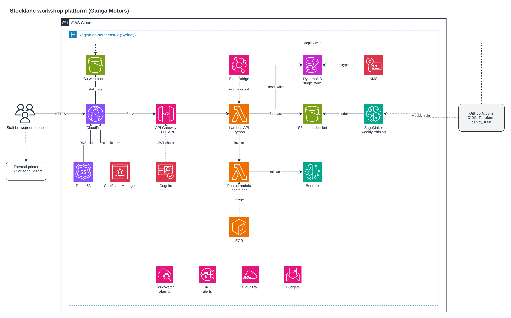
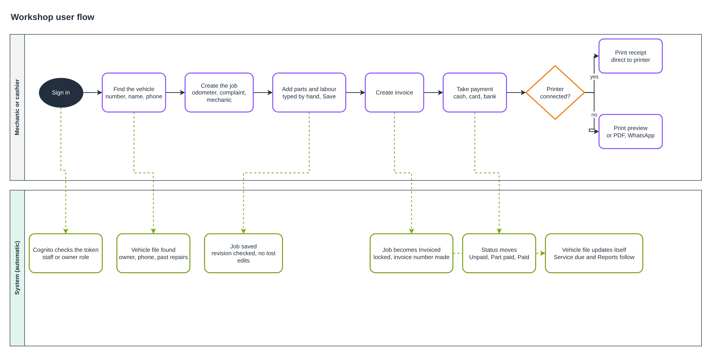

# The Stocklane story

## The problem

A vehicle workshop runs on small, constant decisions. Which part is running low? Which car is back for the third
time this year? Who still owes money? Ganga Motors, a workshop in Anuradhapura, kept the answers in people's heads,
on paper and in a phone full of messages. Parts were taken from the shelf without being written down, and a
customer's repair history lived only as long as the mechanic remembered it.

Stocklane started as the fix for the shelf: scan or photograph a part, take it out or put it back, and see what needs
reordering. It grew into a small platform with two parts that deliberately never touch each other.

## Two halves, one platform

**Stock.** Every change to a quantity is one transaction. The quantity, the ledger entry, the day total and the
idempotency record commit together, so a retry after a bad connection never counts a part twice. A nightly forecast
and a weekly photo-training job keep the reorder suggestions and the photo matching improving without anyone
operating a server.

**Workshop.** A job per visit, a file per vehicle, invoices with payments, and a "service due" list. The
mechanic types parts and labour by hand, so a workshop mistake can never unbalance the stock ledger. An invoice is a
locked record: it gets a number like `INV-20261110-D416D7`, the job becomes Invoiced, and the PDF is always rendered
from the saved invoice, so what is printed can never drift from what is stored.

## Built to cost almost nothing

A workshop does not need a cluster. Stocklane is serverless on AWS in Sydney: CloudFront and a private S3 bucket for
the app, one HTTP API in front of one Python Lambda, DynamoDB on demand, Cognito with MFA for sign-in, and a container
Lambda for photo matching. When nobody is using it the cost is close to zero, and it runs at about two to three
dollars a month at workshop scale.

The diagram is editable: open [`images/stocklane-architecture.drawio`](images/stocklane-architecture.drawio) at
app.diagrams.net. The icons are the official AWS set that draw.io ships.

## Built by pipeline, not by hand

Nothing is installed on a laptop. A one-time bootstrap creates the Terraform state bucket and a restricted CI user.
After that, GitHub Actions does everything: it checks formatting and tests, applies Terraform, builds and ships the
web app, trains the photo model each week and releases it only if it beats the current one, and publishes the
nightly forecast. Destroying the whole stack is one workflow too.

## A day at the counter

The mechanic signs in, finds the vehicle by number, name or phone, opens a job, types the parts and labour, and
creates the invoice. The customer pays in cash, by card or by bank transfer, and the status moves from Unpaid to
Part paid to Paid. The vehicle file updates itself, and the next service shows up on the "service due" list.

### Printing that adapts

There is one **Print** button and one **Printer** menu. With a thermal receipt printer connected over USB or serial
(Chrome or Edge), a receipt prints straight away, with no dialog. Without one, the browser print preview opens and the
bill lays itself out for the paper chosen there, A4 or a narrow receipt roll. **Download PDF** builds the invoice in
the browser from the saved invoice, so it does not depend on the server being reachable.

## Safe by default

Sign-in requires MFA and has two roles, OWNER and MECHANIC. Two people editing one job are protected by a revision
number: the second save is refused with a clear message instead of silently overwriting the first. Names are English
only, so the PDFs and receipts always print correctly. Data is encrypted with a KMS key and DynamoDB keeps
point-in-time recovery.

## What comes next

- Link job parts to the stock system: pick a part, deduct it automatically, warn when it runs low.
- Estimates the customer approves before work starts, and service reminders by WhatsApp or SMS.
- Dealer-style bill details: VIN, job card number, part numbers and a warranty line.

For the setup steps see the [README](../README.md); for daily use see [WORKSHOP.md](WORKSHOP.md); for
operations see [OPERATIONS.md](OPERATIONS.md).
